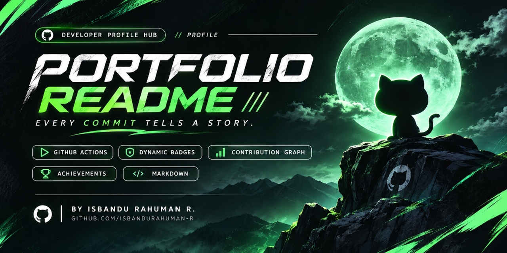

  

# ISBANDU RAHUMAN R.

**AI & Data Science Student · Software Developer · Systems Builder**  
*Chennai, India · Panimalar Engineering College*

---

### ✦ Focus & Engineering Philosophy

I design and build software spanning **Artificial Intelligence**, **Computer Vision**, **Post-Quantum Cryptography**, and **Full-Stack Web Systems**. My focus is on writing clean, maintainable, well-architected code with practical real-world utility—from real-time WebGL physics simulations to multimodal misinformation detection engines.

---

### ◈ Live Production Deployments & Web Applications

Ten of my web applications and platforms are deployed and running live in production:

| Project | Live Production URL | Technology Stack | Experience Type |
| :--- | :--- | :--- | :--- |
| **Developer Portfolio** | [rahumanportfolio.vercel.app](https://rahumanportfolio.vercel.app) | HTML5 · CSS3 Glassmorphism · JS · Vercel | Production Developer Hub |
| **KAGE CARROM** | [isbandurahuman-r.github.io/KAGE-CARROM](https://isbandurahuman-r.github.io/KAGE-CARROM/) | React 19 · Vite 8 · Matter.js · Web Audio API | 2D Physics Tabletop Game |
| **KAGE DRIFT** | [isbandurahuman-r.github.io/KAGE_-DRIFT](https://isbandurahuman-r.github.io/KAGE_-DRIFT/) | Three.js · TypeScript · Vite · GitHub Pages | 3D Anime Racing Game |
| **3D CHESS** | [isbandurahuman-r.github.io/3D-CHESS](https://isbandurahuman-r.github.io/3D-CHESS/) | HTML5 · Three.js · WebGL · Minimax AI | Spatial Raycasting Chess |
| **3D ARENA** | [isbandurahuman-r.github.io/3D-ARENA](https://isbandurahuman-r.github.io/3D-ARENA/) | WebGL 2.0 · GLSL Shaders · Three.js | Procedural 3D Graphics |
| **CAREER DNA** | [isbandurahuman-r.github.io/CAREER-DNA](https://isbandurahuman-r.github.io/CAREER-DNA/) | HTML5 · CSS3 Grid · JavaScript ES6 | Interactive Career Roadmap |
| **PROJECT PRANK** | [isbandurahuman-r.github.io/PRANK](https://isbandurahuman-r.github.io/PRANK/) | CSS Keyframes · Glitch Shaders · Web Audio | Creative Interactive Experiment |
| **BIRTHDAY** | [isbandurahuman-r.github.io/BIRTHDAY](https://isbandurahuman-r.github.io/BIRTHDAY/) | HTML5 Canvas · Confetti Engine · Audio | Interactive Celebration Card |
| **MOON HERO** | [isbandurahuman-r.github.io/FIRST_LANDPAGE](https://isbandurahuman-r.github.io/FIRST_LANDPAGE/) | HTML5 · CSS3 Flexbox · Typography | Atmospheric Landing Page |
| **CALCULATOR** | [isbandurahuman-r.github.io/_CALCULATOR_](https://isbandurahuman-r.github.io/_CALCULATOR_/) | JavaScript ES6 · CSS Grid · Keyboard Nav | High-Precision Web Tool |

---

### ❖ Core Technical Competencies

- **Programming Languages:** Python, TypeScript, JavaScript (ES6+), HTML5, CSS3, SQL, C/C++
- **AI & Computer Vision:** OpenCV, MediaPipe, Ultralytics YOLOv8, PyTorch, Scikit-Learn
- **Web & Frameworks:** React 19, Next.js 14, Three.js, WebGL, Vite, Tailwind CSS, FastAPI
- **Systems & DevOps:** Docker, Git, GitHub Actions (CI/CD), Post-Quantum Cryptography (Kyber/Dilithium), Asynchronous Programming (AsyncIO)
- **Databases & Storage:** SQLite, PostgreSQL, CSV Data Modeling, Local-First Storage

---

### ◆ Featured Flagship Projects

#### 01. [KAGE CARROM](https://github.com/ISBANDURAHUMAN-R/KAGE-CARROM) — 2D Physics Carrom Engine
- **Stack:** React 19 · Vite 8 · Matter.js · Tailwind CSS · Web Audio API · GitHub Pages CI/CD
- 2D tabletop Carrom simulation featuring zero-gravity rigid-body dynamics, official tournament referee system, procedural synthesizer, and raycasted AI opponents.
- › **[Play Live Demo](https://isbandurahuman-r.github.io/KAGE-CARROM/)**

#### 02. [KAGE DRIFT](https://github.com/ISBANDURAHUMAN-R/KAGE_-DRIFT) — 3D Anime Racing Game
- **Stack:** TypeScript · Three.js · Vite · WebGL · GitHub Pages CI/CD
- High-octane WebGL racer featuring decoupled vehicle physics, procedural track generation, custom liveries, and automated GitHub Pages deployment.
- › **[Play Live Demo](https://isbandurahuman-r.github.io/KAGE_-DRIFT/)**

#### 03. [TRUVEX](https://github.com/ISBANDURAHUMAN-R/TRUVEX) — Multimodal Misinformation Detection Platform
- **Stack:** Python · FastAPI · Docker · Pytest · NetworkX
- AI-driven platform that decomposes viral social claims into testable assertions, cross-examines independent authoritative evidence, and scores credibility in real time.

#### 04. [VEHIX](https://github.com/ISBANDURAHUMAN-R/VEHIX) — Smart Mobility & Vehicle Vision Analytics
- **Stack:** TypeScript · Next.js · Ultralytics YOLOv8 · PyTorch · Tailwind CSS
- End-to-end computer vision platform combining a FastAPI YOLOv8 neural detection backend with a reactive Vite + React dashboard for vehicle classification, counting, and lane tracking.

#### 05. [INVISIBILITY KYOKKO](https://github.com/ISBANDURAHUMAN-R/INVISIBILITY---KYOKKO) — Gesture-Controlled Virtual Camera
- **Stack:** Python 3.11 · MediaPipe · OpenCV 4.10 · Virtual Camera API
- Real-time background replacement and optical illusion system driven by live hand gesture recognition and adaptive background subtraction.

#### 06. [QUANTUM THREAT](https://github.com/ISBANDURAHUMAN-R/QUANTUM-THREAT) — Post-Quantum Cryptography Toolkit
- **Stack:** Python · Lattice Cryptography · Crystals-Kyber · Dilithium · Shor's Algorithm Simulation
- Benchmarking classical encryption vulnerabilities against simulated quantum algorithms and evaluating NIST post-quantum cryptographic standards.

#### 07. [NEXORA](https://github.com/ISBANDURAHUMAN-R/NEXORA) — Adaptive Learning & Skill Tree Platform
- **Stack:** Next.js 14 · TypeScript · FastAPI · SQLite · Tailwind CSS
- Modular education platform featuring dynamic prerequisite skill trees, interactive learning nodes, and personalized progression analytics.

---

### 彡 Verified GitHub Activity

  
  

---

### ◈ Contribution Activity

  

---

### § Development & Maintenance Cadence

- **Daily:** Code commits, issue triage, and development on active projects.
- **Weekly:** Automated test verification, dependency review, and performance checks.
- **Monthly:** Repository audits, security review, and live deployment verification.

 

  <h2><code>BUILD. CREATE. INNOVATE.</code></h2>
  <h3>Thanks for exploring my GitHub profile.</h3>
   
  
    
  
© ISBANDU RAHUMAN R &nbsp;•&nbsp; ALL RIGHTS RESERVED

